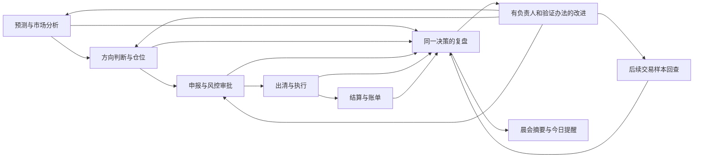

# 复盘中心重建：以真实决策为对象

> 2026-09-09 · #2033 的新建设基线，取代《工作台 v2》的五页面和全量模板迁移前提。v1、v2 仅保留设计与实施历史。
> 配套实现：`src/views/ReviewCenterView.vue`、`src/views/review/ReviewWorkbenchView.vue`、`src/components/review/workbench/`、`src/services/review/decisionWorkbench.ts`。
> 默认入口：`/xhjy/review`（兼容原 `?layout=decisions` 链接）；历史专题入口：`/xhjy/review?layout=classic`。必须由 dljy-web 启动；无需另一个 HTML 原型服务器。
> **交付状态**：已将接通既有真实接口的决策复盘页面设为默认入口，历史专题通过页面按钮进入并可返回；新增复盘对象、账本、事前快照及效果评估接口仍是建设计划。验证版不代表正式结算或完整决策评价已上线。

## 一、重新确定的四项基础

### 1. 产品边界：复盘中心负责完整复盘

本次重建对象是 `/xhjy/review`。一日作业台中的晨会复盘只是当日交易准备的一步：查看上一交易日的重要发现、确认今天要执行的提醒，并跳到复盘中心的具体对象继续调查。晨会不承担完整结算、策略验证和历史研究。

复盘中心支持在结果刚到达时核查、在账单到达后核对、在后续样本积累后验证改进。三个时间点可以属于同一对象的不同阶段，不能要求日后才到达的账单成为次日晨会的前置条件。

### 2. 复盘对象：一项真实业务决策及其执行链

日期、主体和地区是筛选条件；日历上一天和一份模板都不天然等于一笔交易。

| 业务线 | 复盘对象 | 当时要保存什么 | 事后核对什么 | 可形成什么改进 |
|---|---|---|---|---|
| 日前申报 | 一次申报决策及其有效版本 | 负荷/出力与价格预测、仓位、报价理由、风险检查、人工改动、提交回执 | 申报与出清、出清与执行、实际结算；分别说明差异 | 预测修正、报价方式、风险预算或操作流程的调整建议 |
| 日内/实时调整 | 一次增减仓或保持不动的决定 | 当时敞口、可交易窗口、价格信息、限制与理由 | 是否执行、成交条件、暴露变化、后续费用 | 调整触发条件、执行方式、升级处置要求 |
| 中长期与现货衔接 | 一次补仓、减仓或保持仓位 | 合约曲线、覆盖率、参考价格、可用限额、备选动作 | 实际覆盖与敞口、跨账期成本、风险变化 | 合约配置和补仓纪律的调整建议 |
| 新能源 | 一次带物理出力约束的发电申报 | 当时预测版本、设备可用性、限发信息、申报理由 | 预测误差、限发/故障、申报执行和结算影响 | 模型问题、设备事实和策略选择分开处理 |
| 储能 | 一次可行的充放电计划及调整 | 荷电状态、功率/容量、效率、可用窗口、衰减成本假设 | 计划与执行、约束偏离、实际充放成本与收入 | 调整价差门槛、执行窗口或约束模型 |

未执行、被否决和主动不交易的决定也可以复盘，但必须有当时留下的依据；不能事后为“没抓到的机会”虚构一笔决策。策略版本和交易组合可以成为跨对象研究范围，不能把同一交易的 96 个时段当作 96 次独立策略试验。

交易对象、决策记录和结算范围之间只有在证据明确时才关联。当前验证版把申报和决策日志作为两个明确入口，**不以同日、同金额或排序邻近推断它们属于同一笔交易**。结算汇总也不能任意分摊到某一申报。

### 3. 用户任务：结果核验、决策评价、改进验证

这三项是业务任务，不是要求后台仅有三个服务，也不是把旧六维改三个名字。市场、偏差、风险是解释当前对象时调用的分析工具；报告和模板是工作产物。

1. **结果核验**：发生了什么，数据能否对齐，差异来自哪些时段，哪些金额可以确认。
2. **决策评价**：当时知道什么、有什么可选动作、为什么这样做，过程质量与事后结果分别如何。
3. **改进验证**：下次在什么条件下改变什么，由谁实施，何时用什么证据检验。

经营结果、相对事前基准的经济增益、决策过程质量分开表达。结果有利但过程缺乏依据的决策仍需改进；结果不利但符合当时信息和风险约束的决策不能直接判错。

### 4. 模块协作：证据进入复盘，改进回到原业务模块

| 来源/目标模块 | 在复盘中的交互 | 上下文要求 | 本次状态 |
|---|---|---|---|
| 申报工作台 | 选择申报，读取本单曲线和留痕；返回原申报核实 | 单据标识、交易日、地区、会话授权；读取失败停止该对象分析 | 已接线；原申报台已消费对应单号与交易日 |
| 决策日志 | 查看原判断与理由；只回填复盘结论 | 原日志不可改写，结论使用既有回填接口 | 已接线；未做日志与申报的猜测关联 |
| 结算资料 | 当日汇总与厂站明细单独显示 | 授权范围、地区、账期；不当成单笔申报结果 | 云南既有结算接口已接线 |
| 预测与市场分析 | 查看当时实际采用的版本，创建模型/预测问题 | 发布时间、首次取得时间、采用记录、实体与交付时段 | 当前只展示单据内已有留痕；完整版本链接待后端 |
| 风控与仓位 | 查看当时约束，提出待审批调整 | 原限额版本、敞口、批准范围、审计 | 计划；不直接修改在用限额或历史申报 |
| 改进记录 | 带对象和时段建立措施；补充人工验证记录 | 当前会话、幂等、负责人、回查日、验证办法 | 已接既有存储；关联暂保存在业务文字，结构化引用待扩展 |
| 晨会 | 只带重要发现、未解决问题与本日适用措施 | 所复盘交易日与当前作业日分别保存 | 既有晨会深链仍保留；新的摘要消费接口待接线 |
| 报告与历史专题 | 按需打开，历史归档和原功能可访问 | 继续现有授权；正式报告将绑定同一复盘版本 | 保留原入口；历史界面文案及报告还需迁移 |

## 二、偏差部分的参考价值与改造取舍

**保留其分析能力，重做计算边界和页面组织。** 现有曲线、异常时段和明细是交易员能实际使用的资产；旧页面、罚款标签及大段技术解释不作为新设计基线。

| 现有内容 | 取舍 | 新用途或理由 |
|---|---|---|
| 分时电量曲线、热力条、明细与导出 | 保留并重组 | 一张主图、一组明细；选择时段后查看数值并带入改进记录 |
| 申报与出清比较 | 加强 | 与执行偏差分开；读取本笔申报保存的出清结果，先支持确有来源的核查 |
| 申报与平台实时电量比较 | 有条件保留 | 仅在同主体、同日期、同粒度且来源明确时比较；山西公司回放不分配给任意厂站申报 |
| 偏差率 | 重定义展示 | 分母、符号、时间覆盖与零申报情况明确；不以日均偏差率判断逐时段是否超带 |
| 考核电量与估算费用 | 有条件保留，退出无依据的首屏指标 | 只有适用规则及所需价格齐备时才出数；不把缺价按零考核解释 |
| 云南结算三段式 | 保留并独立 | 中长期 + 日前增量 + 实时增量；增量不叫偏差罚款，电费不叫净利润 |
| 周月聚合 | 改为跨对象研究 | 按可比范围聚合并报告覆盖，不用聚合掩盖缺数；账期不随日历选择偷换 |
| 月度偏差费用按天均摊“对账” | 取消 | 没有分日依据就只能在原账期核对 |
| 责任归因选择器 | 改为调查后的结论 | 先区分预测、策略、执行、物理约束和市场影响；相关性不能直接确定责任 |
| 全量模板清单、模板编号、技术状态与报告常驻侧栏 | 退出主要工作区 | 原流程逐项判定保留、合并或退役；不设必须迁完 31 套的验收要求 |
| 连亏代理、统一“30 笔才有效”、填表覆盖率 | 重新论证 | 样本独立性、风险和业务动作不同；不将填表数量当作复盘价值 |

实际核查确认：截图中结算有数字、偏差没有数字，是两种数据粒度及口径分别接入的结果。不是把一组字段换名或把日量平铺到 96 点即可解决。

## 三、具体前端表征和布局

### 结果核验

首屏从上到下：标题/地区/交易日 → 复盘对象选择 → 三项任务 → 当前对象的可用证据。报告不常驻右栏。

- **当日资料总览**：先展示已到达的结算资料与厂站分布；分时缺口缩成一条有业务原因的提示，不占一张空图。
- **选中申报**：对象摘要 + 申报/出清曲线 + 差额热力条 + 当前时段 + 差额较大时段；完整明细按需展开。
- **选中独立决策日志**：明确它尚未关联成交/结算，不提供猜测的收益卡；主操作是查看当时判断。
- 金额用“结算总电费”“现货购电成本”等完整名称。图表单位明确；同一图不混功率和电量，电价独立切换。零值可见，缺值留空，断点不连线。

图表固定为解释当前问题服务：电量图说明发生在哪些时段，电价图提供当时市场背景，费用贡献图必须等服务端账本及可比基准具备后再出现。没有数据就不画坐标空架，不使用演示曲线补位。

### 决策评价

先显示原始判断、理由与留存时点，再允许写复盘结论。申报内按“市场判断 → 申报理由 → 方向/仓位 → 出清后处理 → 合约调整”查看相关证据。每项说明有无留存，未知时点不补猜。

正式版本需提供“当时视角/事后结果”两个服务端隔离视图。当前记录并不等于不可变的事前版本，因此验证版明确只呈现留痕，不宣称已经完成公平回放，不显示胜率、最优动作或系统评分。

人工结论围绕三问：当时信息够不够、推理和风险约束是否合理、哪些判断应保留或改进。AI 可整理事实、提示缺口，但不代填本人结论、责任或批准事项。

### 改进验证

从时段或决策进入时自动带入来源。交易员只需填写：具体改变、负责人、回查日期、验证办法。下方是已有措施，可按状态和文字查找。

完成时须写实际验证记录，不能只点“完成”就显示“已有效”。验证版使用现有存储记录人工回查，标题为“已记录验证”；正式因果效果、样本窗、基准版本和受控状态机留给后端扩展。尚未证明改善的记录不计入策略增益。

### 文案、权限和异常

界面、工具提示、导出、报告和 AI 输出均不得暴露数据库字段名、内部表名、接口枚举或议题编号。所有系统提示经业务词典输出：什么资料未到、影响哪项判断、下一步可做什么。未知错误显示可理解的失败，技术详情只入诊断日志。

新验证界面已使用固定业务名称和受控错误文案。旧专题与历史报告仍是待迁移面，不将它们认定为通过这项验收。不能用全局字符串替换删除真实历史判断来伪造文案达标。

加载/缺资料/读取失败/权限不足/模拟演练/口径未核验分别呈现。不同数据源独立成功，但同一图表和明细使用相同输入。换公司、日期、地区或对象时立即清空不属于新范围的值，慢响应不能回填。窄屏纵向排布，明细表局部滚动。

### 页面缓存与导航约束

复盘中心由全局 `RouterView` 的 `Transition + KeepAlive` 缓存。路由视图必须保留单一且稳定的元素根节点；工作台、独立专题和历史专题的局部模式，只能在 `/xhjy/review` 与 `/xhjy/review/analysis` 两个复盘路由内更新。失活页面仍会观察到全局 `useRoute`，因此禁止直接用任意目标页的 `route.path` 作为异步工作台的 `key`，否则切往其他页面时会在缓存 DOM 搬移期间重建子树，返回后可能只剩页面框架。

组件回归覆盖“复盘中心 → 其他页面 → 复盘中心”连续两轮缓存导航：复盘内容必须恢复，缓存中的工作台不得卸载；独立专题失活后不得读取目标页参数、后台取数或改写目标 URL。发布前的浏览器走查还须核对生产环境的 `Transition + KeepAlive` 组合不再出现白屏及 `insertBefore`、`subTree`、空节点相关运行时错误。

## 四、后端和接口建设顺序

后端权威在 dljy 的 `review-system-build-plan.md` 与 `review-v2-contract-plan.md`。建设依赖由交易事实决定，不再由模板数量决定。

1. **统一对象和证据关系**：先确认决策、申报版本、出清、执行、结算各自标识与范围；可查询关联与未关联原因。既有历史数据不自动猜配。
2. **结果与账本**：先做同范围核验和可解释分项，再做收益与贡献；日清和月结不混合，正式账单修订产生新版本。
3. **事前资料**：从今后决策开始可靠留存发布时间、首次可见时间、采用记录、基准和限制；历史缺快照明确不可公平评价。
4. **改进到验证**：扩展现有措施，保存结构化来源、目标模块、实施回执、验证窗和证据；进入原模块生成待审建议，继续原权限链。
5. **跨对象研究与报告**：使用同一对象、账本和版本做周月回顾、策略研究、案例与报告；最后退役无消费者的旧入口和模板。

三类收益不可混合：真实经营结果、相对事前基准的增益、事后同价情景上界。储能替代计划还须满足当时物理与风险约束；未建模市场冲击、成交概率时随结果说明。

市场规则、信息披露与计量结算各有职责，具体公式仍需地区、主体和生效期的权威细则。制度参考：[国家发展改革委、国家能源局《电力现货市场基本规则（试行）》](https://zfxxgk.nea.gov.cn/2023-09/07/c_1310741791.htm)、[国家能源局《电力市场信息披露基本规则》](https://zfxxgk.nea.gov.cn/2024-01/31/c_1310763726.htm)。这些通则不替代项目待核验的地区考核口径。

## 五、从可操作设计到正式可用的验收

验证版接线：申报分页读取与原单跳转、云南结算汇总/明细导出、同单申报/出清比较、山西公司级分时回放、决策结论回填、改进措施保存与人工验证。没有添加虚构业务数据或自动交易写入。

仍未实现：统一业务对象接口、单笔实际量与结算匹配、权威完整净收益、事前快照回放、约束内替代方案、措施跨模块实施回执、因果效果验证、全部历史报告/专题的业务文案改造。默认入口已切换；上述能力缺口仍须明确提示，入口切换不代表完整后端能力已交付。

正式替换须通过以下场景，而非检查页面数和模板数：

| 场景 | 必须观察到的行为 |
|---|---|
| 云南结算有数据但无分时实际量 | 结算照常可核验；仅执行偏差不可算 |
| 选中一笔有出清的申报 | 同单曲线、异常时段、原申报跳转对应；公司结算不冒充本单结果 |
| 指定申报不存在/越权/错地区 | 明确阻断该对象，不换成另一笔或合成基准 |
| 跨公司、跨日、跨地区或快速换单 | 不短暂展示上一对象指标，慢响应不覆盖新范围 |
| 日志与申报只有同日关系 | 分开复盘，不能显示“已关联” |
| 缺点、零申报、负电价、重复时点 | 不零填、不移位；图表和导出一致 |
| 修改当时记录或资料迟到 | 创建可追踪修订；当时视角不出现未来资料 |
| 月度结算项目只有月值 | 保留月账，禁止日均摊伪对账 |
| 写入超时或权限不足 | 保留草稿并核实回执，不假成功、不本地替代持久化 |
| 改进实施完成但证据不足 | 继续回查，不能自动变成“有效” |
| 模拟单/模拟结算 | 页面和导出均清楚标记，不能混入真实策略成绩 |
| 交易员试用 | 能完成“发现一个差异→找到依据→留下改进→再次找到并回查”，关闭 AI 也能完成 |

验证命令：`npm run check`、`npm run lint`、`npm run test:coverage`、`npm run build`。新增回归覆盖范围/乱序/缺点/零值及工作流持久化边界。浏览器走查不向真实记录写测试结论；写入交互用隔离测试验证。

### 本轮验证记录（2026-09-09）

- 类型检查、静态检查、全量覆盖率测试与生产构建均通过；194 个测试文件、2198 项测试通过，本轮新增 18 项工作流与数据边界回归。
- 静态检查保留既有 288 条类型警告；测试环境的连接拒绝/中止日志、构建体积提示没有导致检查失败。
- 浏览器读取云南 2026-05-31 的既有结算资料，核对 32 座厂站汇总、展开与搜索；检查桌面和 390 像素窄屏布局。由于该日没有可选申报，不以本次浏览器走查冒充真实单笔出清曲线验收；相关交互与数据边界已用隔离测试覆盖。
- 浏览器未提交测试改进或复盘结论。写入成功、失败保留输入、证据不足继续回查通过服务隔离测试验证，仍需授权的真实业务试用验收。

## 六、分析与报告实施计划（2026-09-09 用户批准）

本轮在既有对象流内补齐四项，关联 #2875：

1. 留存预测/申报对照：使用本单保存曲线和时间，不重新运行历史模型；图表、时段和导出共用事实。
2. 执行时间线：风控、审批、回执、出清与改进依据可核查，未知时间单独展示。
3. 上下文智能分析：启动时固定公司、地区、交易日、对象与版本，保留选中时段及来源；切换对象关闭旧分析，模型输出只是建议。
4. 报告工作区：确定性事实草稿→智能体成稿建议→人工编辑→导出或按既有工具审批归档；AI 不覆盖人工正文，不代签人判结论。

验收：同单对照与空态；时间线排序及资料缺口；新旧对象会话不串；AI 失败不假成功；报告保留证据快照与模拟标记；人工编辑不被后来的 AI 结果覆盖。前后端按改动面运行类型/单测/构建/提示词与契约门禁，浏览器核对已有演练单，不向真实申报写测试结果。

### 本轮实现与使用边界

已落在项目代码：`reviewEvidence.ts` 对同对象资料进行中文业务投影、范围校验与固定副本取材；`IntervalEvidencePanel.vue` 增加留存预测与申报对比；`ReviewWorkbenchView.vue` 使用风控、审批、回执和出清时间线；`ReviewAssistantWorkbench.vue` 提供依据查阅、按对象/时段分析、报告编辑、建议显式追加、草稿下载与归档审批。`AgentChatPanel.vue` 增加可选业务显示模式和禁止自动恢复旧会话的参数；仅成功且有正文的分析返回可追加建议，错误或待审批不会冒充成稿。

报告与改进草稿按当前页面内的公司、地区、日期和对象分别保留，离开页面/刷新提示未保存内容；不会在浏览器持久化业务草稿。AI 不自动覆盖人工稿、不自动归档、不自动改申报。实际归档仍依赖既有模型服务、报告工具和人工审批；下载文件不代表已归档。后台对象提示需随 dljy#2879 一起发布。

验证重点：范围错配必须拒绝、曲线缺值保留、预测不重跑、模拟性质贯穿正文与导出、建议不覆盖人工稿、编辑撤销人工核对状态。默认入口迁移已完成；完整后端证据认证和单笔账本仍属后续阶段。

本轮审查修正：复盘申报读取显式带当前选中公司；提示键使用注册常量；仅回执携带演练标记也显示模拟；读取未完成时阻止写入，避免旧列表覆盖新记录；下载或清空报告、成功保存改进后清除未保存状态。回归覆盖公司请求头、提示键、回执模拟和读取/写入并发。
